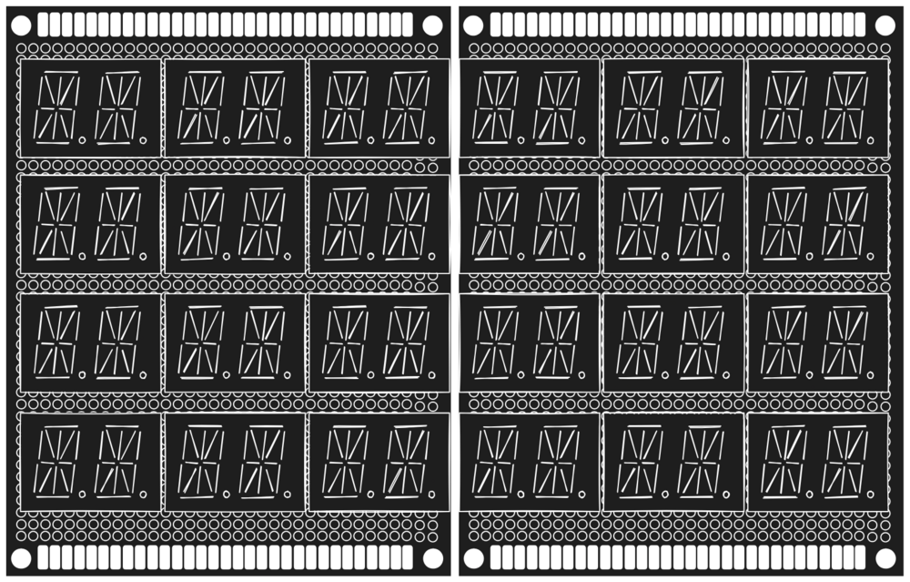

# Greenboard

Greenboard is a custom embedded display project built around a 14-segment matrix designed to show alphanumeric characters and symbols in a compact, readable format. The project combines custom hardware prototyping with firmware development, creating a flexible display platform.

## Hardware Design Overview

The prototype design is shown below. A single board has four rows and three columns of 2-digit 14-segmented(15 including the dot) led display. Each of the board can be individually driven. The 14-segmented display is driven by HT16K33 LED driver. Check out more on [hardware](./docs/HARDWARE_README.md)

