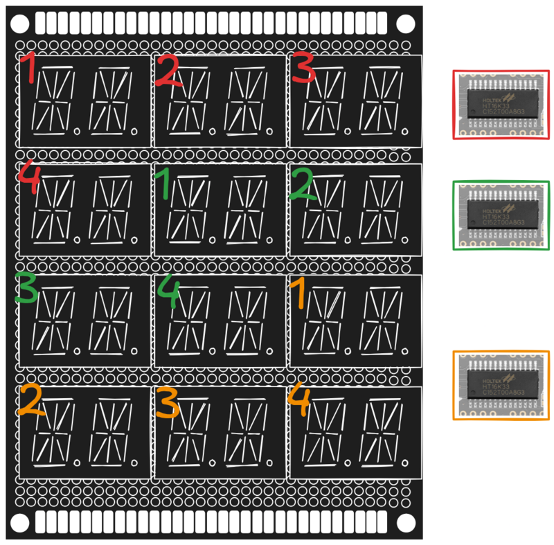

# Hardware Design

A single HT16K33 driver can handle 8 digits of 16-segments, so it can easily drive the 15 segments. Also, this driver has a 3-bit address pin which can set the lower 3-bits of the 0x7X address (0x70, 0x71, 0x72, ...). In one board we have $4 * 3 * 2 = 24$ digits, each LED driver can handle 8 digits, so $24/8 = 3$ LED driver module for one board.

But since the over the shelf prototyping PCB have fixed standard dimensions. It can only accomodate three 2-digit LEDs. So managing the routing layout is going to be a nightmare, since a single LED driver can 4 of those 2-digit module but only 3 can be accomodated in a row. We can have an LED driver for each column which would make the routing layout and LED control much easy but then we would need to cycle through all the LED drivers every time. If we have the layout as shown above, we would only need to updated it sequentially. If we don't have any characters in the next line we would not need to write to that LED driver, thereby reducing the write cycles.